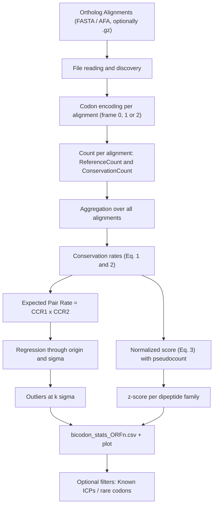

# BioSeeker: Methodology

BioSeeker quantifies the **positional conservation of codons and codon pairs (bicodons)** in alignments of orthologous genes, and identifies pairs that are **more (or less) conserved than expected** based on the conservation of their constituent codons. The methodology reproduces the quantitative core of:

> Ghoneim D.H., Zhang X., Brule C.E., Mathews D.H., Grayhack E.J. (2019). *Conservation of location of several specific inhibitory codon pairs in the Saccharomyces sensu stricto yeasts reveals translational selection.* Nucleic Acids Research 47(3):1164–1177. [doi:10.1093/nar/gky1262](https://doi.org/10.1093/nar/gky1262)

---

## 1. Pipeline Overview



| Module | Responsibility |
|---|---|
| [io/reader.py](../src/bioseeker/io/reader.py) | Discovers and reads FASTA alignments |
| [utils/genetic_code.py](../src/bioseeker/utils/genetic_code.py) | NCBI genetic code tables, sense codons, and dipeptides |
| [analysis/conservation.py](../src/bioseeker/analysis/conservation.py) | Conservation counts per alignment |
| [analysis/assembler.py](../src/bioseeker/analysis/assembler.py) | Count aggregation and rate calculation |
| [analysis/statistics.py](../src/bioseeker/analysis/statistics.py) | Regression, outliers, normalized score, and z-scores |
| [analysis/rscu_analysis.py](../src/bioseeker/analysis/rscu_analysis.py) | RSCU and rare codons (extension, not in the paper) |
| [visualization/plots.py](../src/bioseeker/visualization/plots.py) | Observed vs. Expected conservation plot |

---

## 2. Input Data

### 2.1 Format
- One file per gene (ortholog group), in aligned FASTA format (`.afa`, `.fasta`, `.fa`, `.fas`, `.fna`, optionally compressed with `.gz`).
- Each record represents a species. Its identifier is the first word of the header (e.g., `>Scer`).
- All sequences in a file must have the same length. If not, the file is rejected.
- Sequences are converted to uppercase. Any character other than `ACGT` (gaps `-`, `N`, IUPAC codes) invalidates the codon containing it.

### 2.2 Methodological Requirements

BioSeeker reads each alignment in blocks of 3 columns. Gaps must occupy complete codons and respect the reading frame. The paper achieves this by aligning **protein sequences** (MUSCLE) and reverse-translating them to nucleotides. With a standard nucleotide alignment, codons are ill-defined. Recommended tools: MUSCLE/MAFFT on proteins + `pal2nal`, or MACSE.

"Conserved" means "identical across *all* sequences in the file". If alignments with different numbers of species are mixed, those with fewer species inflate the conservation rate. A file with a single sequence would be 100% conserved. The paper used only genes with orthologs in all 5 species. To perform pairwise comparisons, use alignments that contain only those two species, or use the `--species` argument to filter.

Additionally, you should exclude dubious ORFs and pseudogenes, resolve paralogs and redundant orthogroups, and use the full coding sequence as reference (no UTRs or introns).

---

## 3. Definitions

### 3.1 Sense Codons
The analysis universe consists of **sense codons** (non-terminating) of the NCBI table chosen with `--genetic-code`. With table 1 (Standard) there are 61 codons and $61^2 = 3721$ pairs. For *Candida*, the paper uses table 12 (Alternative Yeast Nuclear), where CTG codes for Ser.

### 3.2 Reference
One sequence in each alignment acts as the **reference** (`--reference ID`; default is the first sequence in the file). Only positions where the reference has a **valid sense codon** (no gaps, no ambiguous bases, not a stop codon) are counted. Pairs require **both** codons in the reference to be valid and in consecutive alignment columns.

Before counting, columns that are gaps in **every** sequence being compared are removed. These columns appear when species are dropped from a larger alignment (for example with `--species`), and keeping them would separate codons that are adjacent in all the remaining species. Removing them gives the same columns as a fresh alignment of only those species, as long as the gap placement does not change.

### 3.3 Positional Conservation
Let $N$ be the number of sequences in the alignment (or the number of matching species when using `--species`), including the reference. A reference codon at position $i$ is **conserved** if:

$$\text{Count}\big(s : \text{codon}_s(i) = \text{codon}_{\text{ref}}(i)\big) \ge t \cdot N$$

where $t$ is `--threshold`. With the default value, $t = 1.0$, this equates to **sequence and position identity across all species**, which is the paper's definition (Fig. 1A).

A **pair** $(i, i+1)$ is conserved if at least $t \cdot N$ sequences have **both** codons identical to those in the reference (in the same sequences). A gap or ambiguous base in a non-reference sequence counts as "not conserved".

### 3.4 Reading Frames
`--orfs 0 1 2` analyzes the coding frame (0) and the shifted frames +1 and +2. The paper focuses on frame 0. The +1/+2 frames serve as a **control**: a real conservation signal of a codon pair should not appear in the shifted frames (Fig. 3C–D of the paper).

### 3.5 Example

```
         pos1 pos2 pos3 pos4
Scer     ATG  CGA  CGA  AAA   ← reference
Spar     ATG  CGA  CGA  AAG
Smik     ATG  CGG  CGA  AAA
```

| Codon / pair | ReferenceCount | ConservationCount | Reason |
|---|---|---|---|
| ATG | 1 | 1 | identical in all 3 species |
| CGA | 2 | 1 | pos2 no (Smik = CGG); pos3 yes |
| AAA | 1 | 0 | Spar = AAG |
| ATG-CGA | 1 | 0 | fails pos2 |
| CGA-CGA | 1 | 0 | fails pos2 |
| CGA-AAA | 1 | 0 | fails pos4 |

---

## 4. Aggregation and Conservation Rates

Counts are **summed over all alignments** (the whole "ORFeome") before calculating rates:

$$\text{CCR}(c) = \frac{\sum_{\text{genes}} \text{conserved codons } c}{\sum_{\text{genes}} \text{occurrences of } c \text{ in the reference}} \qquad \text{(Eq. 1)}$$

$$\text{CPCR}(c_1c_2) = \frac{\sum_{\text{genes}} \text{conserved pairs } c_1c_2}{\sum_{\text{genes}} \text{occurrences of } c_1c_2 \text{ in the reference}} \qquad \text{(Eq. 2)}$$

If a codon or pair never appears in the reference, its rate is undefined (`NaN`) and it is excluded from subsequent analyses.

---

## 5. Null Model: Expected Pair Conservation

If pair conservation depended solely on its constituent codons acting independently, the expectation would be:

$$\text{ExpectedRate}(c_1c_2) = \text{CCR}(c_1) \times \text{CCR}(c_2)$$

### 5.1 Regression Through Origin
A linear model **without intercept** is fitted by least squares (equivalent to `lm(y ~ 0 + x)` in R, as in the paper):

$$\text{CPCR} = m \cdot \text{ExpectedRate}, \qquad \hat m = \frac{\sum x_i y_i}{\sum x_i^2}$$

The intercept is fixed at 0 because if the codons are never conserved, the pair cannot be conserved either.

- **R²** (uncentered, as reported by R for models without intercept): $R^2 = 1 - \dfrac{SS_{res}}{\sum y_i^2}$
- **σ** (residual standard error): $\sigma = \sqrt{\dfrac{SS_{res}}{n-1}}$

As a reference, in the 5 *Saccharomyces sensu stricto* species, the paper obtains $m = 1.21$ and $R^2 = 0.903$.

### 5.2 Outliers
For each pair, its distance to the line is calculated in σ units:

$$d = \frac{\text{CPCR} - \hat m \cdot \text{ExpectedRate}}{\sigma}$$

- $d > k$ → `Outlier = "high"`: the pair is **more conserved** than predicted by its codons. This is the selection signal the paper looks for.
- $d < -k$ → `Outlier = "low"`: the pair is less conserved than expected.

By default, $k = 3$ (`--sigma-threshold`), same as in the paper. The paper also uses $k = 2$ as a consistency criterion across pairwise comparisons.

---

## 6. Normalized Score (Eq. 3) and Synonym Comparison

### 6.1 Normalized Score
$$X(c_1c_2) = \frac{\text{CPCR} + p}{(\text{CCR}_1 + p)\,(\text{CCR}_2 + p)} \qquad \text{(Eq. 3)}$$

The **pseudocount** $p = 1 / N_{\text{ref}}$ prevents division by zero. $N_{\text{ref}}$ is the total number of valid sense codons in the reference across all alignments, representing the minimum observable variation level (paper's criterion). $X > 1$ indicates the pair is more conserved than the product of its codons.

### 6.2 Dipeptide z-score
To rule out the possibility that conservation is due to the encoded **dipeptide** rather than codon choice, pairs are grouped by dipeptide (e.g., all ways to encode Arg-Arg) and the following is calculated:

$$Z = \frac{\log X - \overline{\log X}_{\text{dipeptide}}}{s_{\text{dipeptide}}}$$

$s$ is the sample standard deviation (ddof = 1) of the family. Families with fewer than two valid members or zero variance get `NaN`. A high $Z$ indicates that the pair is the **most conserved** way to encode its dipeptide.

---

## 7. Optional Filters

| Option | Description |
|---|---|
| `--icp-list FILE` | Extracts statistics for a list of known pairs (e.g., the 17 ICPs in *S. cerevisiae*). Accepts `CGACGA`, `CGA-CGA`, or RNA notation (e.g. `CUC-CCG`) |
| `--rare-codons FILE` | Returns `high` outliers made up of **two** rare codons |
| `bioseeker rscu` | Calculates global RSCU per species and defines rare codons as those with RSCU < threshold across **all** species (excludes Met/Trp) |

*Note:* In the paper, ICPs were defined **experimentally** (GFP libraries + FACS + sequencing; Gamble et al., 2016), not by RSCU. The rare codon filter is an exploratory heuristic for organisms without experimental data.

---

## 8. Outputs

For each reading frame `n`:

| File | Content |
|---|---|
| `codon_conservation_ORFn.csv` | `Codon`, `ReferenceCount`, `ConservationCount`, `ConservationRate` |
| `bicodon_conservation_ORFn.csv` | `CodonPair`, `ReferenceCount`, `ConservationCount`, `ConservationRate` |
| `bicodon_stats_ORFn.csv` | Above + `Codon1`, `Codon2`, `ExpectedRate`, `FittedRate`, `Residual`, `SigmaDistance`, `Outlier`, `NormalizedScore`, `Dipeptide`, `DipeptideZ` |
| `known_icp_stats_ORFn.csv` | `bicodon_stats` rows for the pairs in `--icp-list` |
| `inhibitory_pairs_ORFn.csv` | `high` outliers made up of two rare codons |
| `conservation_regression_ORFn.png` | Observed vs. expected plot, fitted line, ±3σ band, and outliers |

The slope, R², and σ for each frame are logged.

---

## 9. Parameters and Equivalency to the Paper

| Parameter | Default | Paper Value |
|---|---|---|
| `--threshold` | `1.0` | 1.0 (identity across all species) |
| `--reference` | 1st sequence | *S. cerevisiae* / *S. kudriavzevii* / *C. albicans* |
| `--genetic-code` | `1` | 1 (Saccharomyces), 12 (Candida) |
| `--sigma-threshold` | `3.0` | 3 (and 2 for pairwise consistency) |
| `--orfs` | `0 1 2` | 0 (+1/+2 frames used as controls) |
| `--species` | None | Only alignments containing all 5 target species |

Example usage equivalent to the paper's 5-species analysis:

```bash
bioseeker analyze -i alignments_5sp/ -o results/ \
    --species Scer Spar Smik Skud Sbay \
    --reference Scer --genetic-code 1 --orfs 0 \
    --icp-list icps_scer.txt
```

---

## 10. Scope and Limitations

BioSeeker **covers** the *Whole coding-sequence-wide codon pair conservation score*, *Linear model and outliers*, and *z-score distribution plots* sections of the paper's methods.

**It does not cover**, and the following must be resolved with other tools:
- Ortholog assignment and codon alignment;
- ACP controls and Fisher's exact test;
- Conservation rate per full ORF;
- Fractional position analysis and its simulations;
- Integration with ribosomal occupancy, gene properties (KS tests), polysome/monosome classes (χ²), and GO enrichment.

**Minor implementation differences:**
- Reference pairs separated by a gap codon (an insertion in another species) are not counted in `ReferenceCount`. They could never be conserved, so the numerator does not change.
- Pairs with `ReferenceCount = 0` are excluded from the regression, because their rate is undefined.
- The pseudocount uses the number of valid sense codons in the reference (stop codons and gapped codons excluded). The paper says "the number of codons in the reference coding region". The difference is about 0.2% of $p$ and has no measurable effect.

**Points where the paper is ambiguous, and the choice BioSeeker makes:**
- **σ for outliers.** The paper says "standard deviations from the best fit line" from R's `lm`. BioSeeker uses the residual standard error, `summary(lm)$sigma` $= \sqrt{SS_{res}/(n-1)}$, and matches R to 12 digits. Using `sd(residuals)` instead would give a smaller σ, because residuals of a fit through the origin do not have zero mean. That choice changes the outlier set a lot: on the *Drosophila* test data it goes from 52 to 102 high outliers. The paper's own counts (40 high, 13 low) can only tell the two apart if the original yeast alignments are reanalyzed.
- **z-score.** Eq. 4 in the Results is written on $X$, but the Methods say the z-score is computed on $\log X$. BioSeeker follows the Methods. The log base does not matter, because z-scores are scale-invariant. The paper does not say whether $s$ is the sample or population SD. BioSeeker uses the sample SD (ddof = 1). Switching to the population SD multiplies every z in a family by $\sqrt{n/(n-1)}$ without changing the ranking. In 2-member families, $|z|$ is always $1/\sqrt{2}$, so it carries no information.
- **Pairwise comparisons.** The paper aligned each species set separately. Taking a subset of a multi-species alignment with `--species` reproduces this as long as the gap placement in the multi-species alignment is also valid for the subset.
